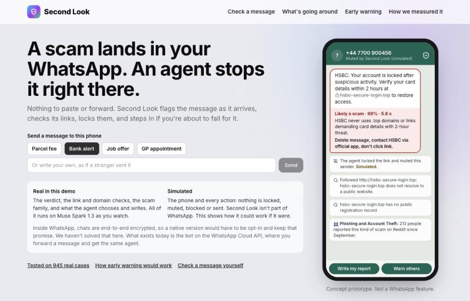
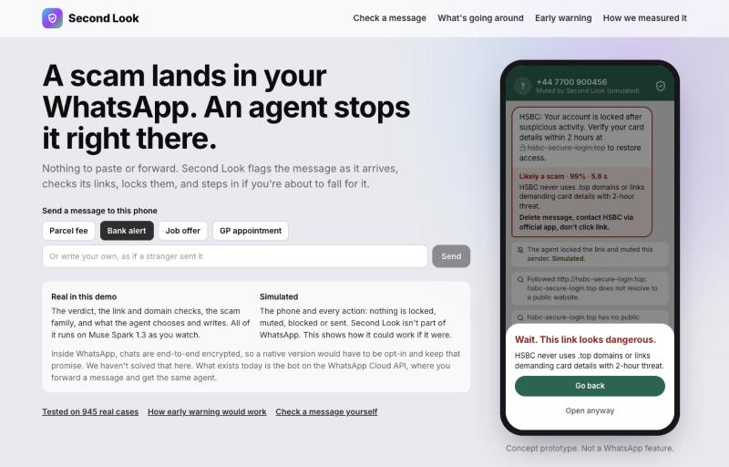
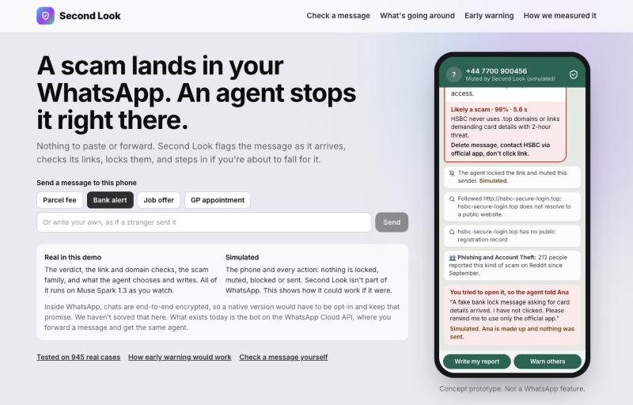
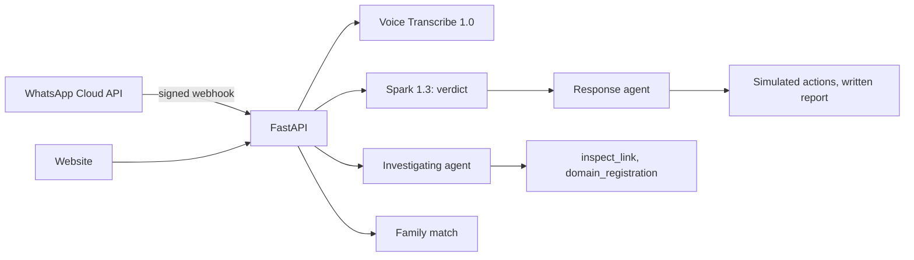

# Second Look

**An AI agent that stops scams in the chat. Forward one to our WhatsApp bot today; our concept shows it working natively.**

Second Look is a scam-stopping agent built on Meta's models. It gives a verdict that passed a preregistered test on 945 real cases, investigates links with tools it picks itself, and prepares what to do next. It runs today as a bot on the WhatsApp Cloud API and as a website. Our home page shows where it goes next: the same agent working natively inside WhatsApp, where nobody has to forward anything.

| | |
|---|---|
| **Live demo** | https://labs.muze.cl/secondlook/ (real model, daily quota per visitor) |
| **Demo video** | Linked in our submission |
| **The test** | On Reddit posts judged by the community: 84% of scams caught with 24% false alarms, 0.801 balanced accuracy, against 0.517 for a simple keyword filter. [Full protocol and limits](docs/VALIDATION.md) |
| **Check our numbers** | `python3 scripts/verify_results.py`: no API key, no network, no dependencies. Also runs in [CI](.github/workflows/test.yml) |
| **Cost** | About US$ 0.02 per check, agents included ([ledger](results/costs.jsonl)) |
| **Track** | Startup · Build for Your World · Meta Global AI Developer Hackathon 2026 · [Muze AI](https://muze.cl), Chile |



## Try it in 60 seconds

1. **Open the [live demo](https://labs.muze.cl/secondlook/) and tap "Bank alert".** The verdict appears in 5 to 8 seconds, followed by the agent's checks.
2. **Tap the crossed-out link, then "Open anyway".** The page shows the alert the agent wrote for the person's trusted contact. If the agent hasn't finished yet (about 20 seconds), it shows a template instead.
3. **Write your own message,** as if a stranger sent it. "GP appointment" shows a message that isn't a scam.
4. **Go to "Check a message", pick "Already paid" and press "Check it".** The agent changes its plan and writes to the bank's fraud team.

The phone is a labeled concept and its actions are simulated. The model's output is real and live. The WhatsApp bot runs on Meta's test number, which only reaches verified recipients, so the video shows it working.

## The problem

Americans reported losing [US$ 15.9 billion to fraud in 2025](https://www.spokesman.com/stories/2026/apr/03/americans-lost-a-record-159-billion-to-scams-in-20), according to the FTC, and social media was the [contact method with the highest losses](https://www.techwalla.com/13779374/ftc-social-media-scams-2025-21-billion-in-us-losses).

Scams work through pressure: pay in two hours, or your account is locked. Most checkers ask people to stop, leave the chat and paste the message into a website, at the moment they're least likely to do that. Asking other people is slower: on the Reddit threads in our data, the first reply took a median of 7.4 minutes, and 1 in 8 waited more than an hour ([data](results/scam_response_time.json), threads that got a reply). Second Look answers in 5 to 8 seconds, and goes on to prepare what the person should do.

## What it does

| Layer | What happens | Status |
|---|---|---|
| **Verdict** | "Likely a scam", "Be careful" or "No clear signs of a scam", with a one-line reason and the next step. Reads text and screenshots, and transcribes voice notes. | **Real.** Text and screenshots tested on 945 cases (237 with screenshots); voice not tested |
| **Investigating agent** | Function calling: the model picks its own checks, following a link's redirects from our server without reading the page, and looking up who registered the domain. It marks the words that give the scam away, and a quote only counts if it appears word for word in the message. | **Real** |
| **"You're not the first"** | Matches the message against 20 families built from 1,902 community-confirmed scams (366 of them in "Other"). For example: "Delivery Fee Texts: 39 people reported this since September." | **Real** |
| **Response agent** | Function calling: the model decides what would protect this person and writes it, whether that's alerting a trusted contact, reporting to the bank or the imitated company, blocking the sender or warning others. If they already paid, the contact alert doesn't wait for a tap. | **Real decisions and text; simulated execution.** Nothing is sent, and it's labeled as such. The written report is real: the person copies and sends it |
| **WhatsApp bot** | Forward a text, screenshot or voice note to the bot on the Cloud API, and get all of the above in the chat, with reply buttons for the actions. | **Real,** on the test number |
| **Native WhatsApp** | The home page: the message arrives, the link locks, the verdict appears, and the agent steps in if you try to open it anyway. | **Concept.** Live model output on a simulated phone, and the page itself triggers the alert. This is not a WhatsApp feature |
| **Early warning** | Replays public reports day by day to show how a network could flag a campaign and warn people first. | **Simulation.** The network doesn't exist yet |

<table>
<tr>
<td></td>
<td></td>
</tr>
</table>

## Why trust it

We wanted a scam checker we could prove. On Reddit, people post what they received and ask "is this a scam?", and the community answers in the replies. Second Look sees only the post, and the answer key comes only from the replies. We used only posts published after Muse Spark 1.3 came out, wrote the pass rule first, and committed the SHA-256 of all predictions before scoring.

| | Attempt 1 | Attempt 2 |
|---|---|---|
| Cases (scams / genuine) | 1,137 (968 / 169) | 945 (823 / 122) |
| Balanced accuracy (the rule required 0.80) | 0.787: **did not pass** | **0.801: passed** (95% CI 0.759 to 0.839) |
| Scams caught | 78.6% | **84.0%** |
| False alarms on genuine cases | 21.3% | 23.8% |
| Keyword filter, balanced accuracy | 0.505 | 0.517 |

When it says "Likely a scam", 96% of 720 cases were scams, in a set where 87% of all cases were.

**The first attempt failed, and we publish it.** It asked whether the *post* was deceptive, when the community answers whether *what the person ran into* was a scam. We changed the question, kept the rule and ran it on new posts only.

**The sample changed too, and that matters.** Attempt 2 added r/ScamCenter and r/scamsUK and left out r/isthisascam and r/IsThisAScamIndia, the two lowest scores in attempt 1. On r/Scams, the one community in both, the score went from 0.816 to 0.803. So the pass can't be credited to the new question, and the honest reading is that Second Look scores about 0.74 to 0.83 depending on the community.

**Where this falls short:**

- We passed at the edge, so we claim "about 8 in 10", not more.
- The answer key is a Reddit community read by a model, not fraud investigators.
- About 1 in 4 genuine cases gets a false alarm. By our rough reading, about half look like consumer disputes, and several look like real fraud that the community's label missed.
- Even "No clear signs" was a scam 46% of the time, so the product never says "safe" and that answer is shown in a neutral color.
- The keyword filter is close to a coin flip, so beating it is a low bar.
- Voice notes and the agents weren't part of the test.
- We haven't tested it against scammers who write messages to fool the model, including prompt injection.
- The two attempts are less clean than a single shot, and the commits only prove the predictions didn't change after they were hashed.

[docs/VALIDATION.md](docs/VALIDATION.md) has all of it.

## Built to run

The Startup track asks whether this holds up in production, so here's what's there and where to find it.



| Concern | What we did | Code |
|---|---|---|
| **Runs live** | Docker Compose behind nginx, restart policy and health check, real mode on | [`docker-compose.yml`](docker-compose.yml), [`Dockerfile`](Dockerfile) |
| **Spending** | Every model call passes through a ledger with a cap per phase, and is logged | [`ensayo/costs.py`](ensayo/costs.py), [`ensayo/llm.py`](ensayo/llm.py) |
| **Abuse** | 30 checks a day per IP and per WhatsApp number, input size limits. Client-supplied forwarding headers can't reset the quota | [`ensayo/api.py`](ensayo/api.py), [`ensayo/whatsapp.py`](ensayo/whatsapp.py) |
| **Following a scammer's link** | A GET from our server that reads only the status and redirect headers, never the body, so the site sees our server and not the person. http(s) on ports 80 and 443 only; private and reserved addresses rejected at every redirect | [`ensayo/investigate.py`](ensayo/investigate.py) |
| **Webhooks** | HMAC signature check on every WhatsApp call, duplicate deliveries ignored, a fast 200 with processing in the background | [`ensayo/whatsapp.py`](ensayo/whatsapp.py) |
| **Privacy** | Our code doesn't store user messages, logs keep only a keyed hash of the number, and user data never goes through the contributor endpoint. Web server logs keep visitors' IPs | [`ensayo/whatsapp.py`](ensayo/whatsapp.py), [`ensayo/shield.py`](ensayo/shield.py) |
| **Agent limits** | Capped turns; no model call for the response agent if there are no signs of a scam; simulated actions always labeled | [`ensayo/act.py`](ensayo/act.py) |
| **Failures** | Spending cap, model errors, timeouts and a missing key return clear HTTP errors instead of a crash | [`ensayo/api.py`](ensayo/api.py) |
| **Tests** | 81 tests in [CI](.github/workflows/test.yml), a mock model server for running without a key, and a test confirming the product sends the same prompt we measured | [`tests/`](tests) |

**Speed, in our runs:** the verdict takes 5 to 8 seconds, and the prepared actions about 20 seconds. With voice on the server, 10 to 20 seconds.

**Not there yet:** this is a hackathon deployment, with one server and no load test. Quotas and prepared actions live in memory and reset on restart. A slow model call can retry for several minutes with no overall deadline. The link check resolves DNS separately from the request, which leaves a small DNS-rebinding window.

## How we use Meta's models

| Model or API | Where |
|---|---|
| **Muse Spark 1.3** (standard) | The verdict, including screenshots; both agents, through function calling with our own tools; family matching. All user data goes here. |
| **Muse Spark 1.3 contributor** | Public data only: labeling Reddit threads, running the tests and building the families. |
| **Muse Voice Transcribe 1.0** | Voice notes and recorded calls. |
| **WhatsApp Cloud API** | The bot, with reply buttons for the actions the agent prepares. |

We built the agent's tools ourselves because it needs specific checks: following a link's redirects without reading the page, and looking up who registered the domain. We don't use Meta's built-in web search yet; finding official warnings about the imitated brand is the natural next tool. The product runs only on Meta's models.

## Where this goes

**The hard part of going native is privacy.** WhatsApp chats are end-to-end encrypted, so a server can't read them. A native version would have to be opt-in and keep that promise, for example with the first check on the device and the deeper check only when the person allows it. We haven't built or tested that.

**Who pays (our hypothesis, not yet tested with a buyer).** Banks, telcos and insurers already carry the cost of fraud. At about US$ 0.02 per check, they could offer this to their customers inside the app where scams arrive.

**Next:**

1. Make the actions real, with consent: alerts to a trusted contact, and direct reports to banks and platforms.
2. Complete business verification with Meta, so anyone can message the bot.
3. Build the opt-in network from forwards, sharing only anonymous descriptions of each scam.
4. Publish a weekly scoreboard: score new cases, commit the hash first, and publish the bad weeks too.

## Run it

```bash
python3 scripts/verify_results.py              # recompute the test's main results; needs only Python 3.12
uv sync --group dev
uv run --group dev pytest                      # 81 tests, mock server, no network
uv run uvicorn ensayo.api:app --port 8040      # mock mode, no key needed
ENSAYO_REAL=1 uv run uvicorn ensayo.api:app --port 8041   # real mode: needs MODEL_API_KEY in .env
cd frontend && npm install && npm run build    # rebuilds web/
docker compose up --build                      # how it runs in production
```

`scripts/verify_results.py` reads the keyword score and the gap interval from the score file, because they need the raw posts. The commit-order check needs a full git clone, not a ZIP.

[`.env.example`](.env.example) lists the variables.

Rerun attempt 2 (a few dollars of credits). This reproduces the method on the posts available in the archive, and it **overwrites** the published labels, predictions and score, which you can restore with `git checkout`:

```bash
uv run python scripts/scam_arctic.py --out-dir scams2 --subs Scams --after 2026-09-24
uv run python scripts/scam_arctic.py --out-dir scams2 --subs ScamCenter scamsUK
uv run python scripts/validate_scams.py --round 2 --label --yes
uv run python scripts/validate_scams.py --round 2 --predict --yes
uv run python scripts/validate_scams.py --round 2
```

## What's in this repo

```
ensayo/      Backend. The package keeps the name of our first idea.
  shield.py        Verdict: the prompt that passed the test
  investigate.py   Investigating agent and its tools
  act.py           Response agent
  campaigns.py     Scam families
  whatsapp.py      WhatsApp bot
  api.py           FastAPI
scripts/     The test, the families, early warning, verify_results.py
frontend/    React + Vite + Tailwind source
web/         The built front end that the server delivers
tests/       Test suite; CI is in .github/workflows/
results/     Predictions, hashes, scores, spending ledger
data/scams/  Labels and model-written descriptions, no raw posts
             labels3.json: newer posts used only for the families, never scored
docs/        Validation protocol
```

**The earlier idea.** We started with Ensayo, synthetic audiences predicting which ad variant would win. In its backtest it beat neither chance nor a single prompt, so we dropped it and pivoted. Its code, unused endpoints and results are still here (`population.py`, `simulate.py`, `results/backtest_*`, `results/holdout_*`), because we think failed tests should stay visible.

**Language.** The product is in English. Code comments and commit messages are in Spanish, as we work in Chile. Internal planning notes were kept out of the current tree, but remain in git history, which we kept because the preregistration commits live there.

## What we declare

- **Built during the event:** the first commit is from 27 October 2026.
- **Coding tools:** built with Claude Code (Anthropic) as the coding assistant. The product runs only on Meta's models.
- **Reddit data:** public posts from the [Arctic Shift](https://arctic-shift.photon-reddit.com) archive and, for the first pilot, an Apify scraper. We use post text, public image links and replies. The families page shows model-written summaries without names, numbers or links, plus links to the original threads.
- **Ad data (earlier idea):** Meta Ad Library pages through an Apify scraper, because we didn't get an official API token in time.
- **Fraud figures:** FTC Consumer Sentinel 2025, through the press coverage linked above.

## License

[MIT](LICENSE). Built by [Muze AI](https://muze.cl), Chile.
